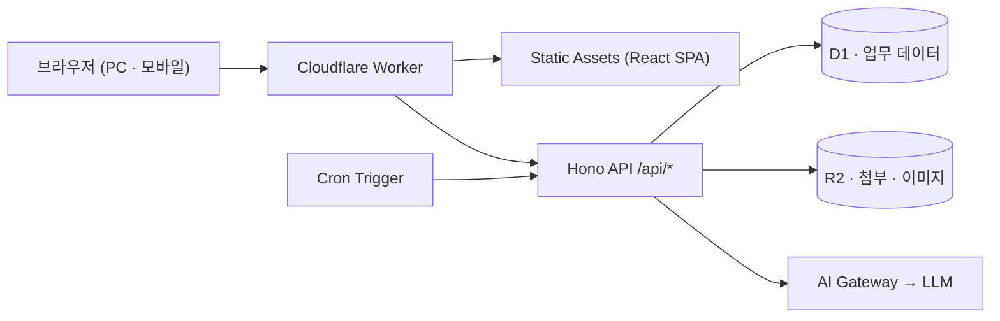
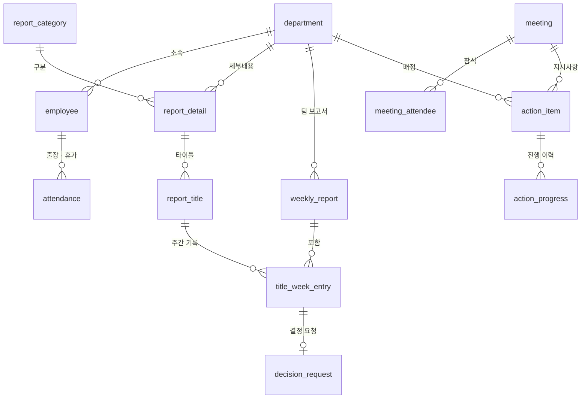
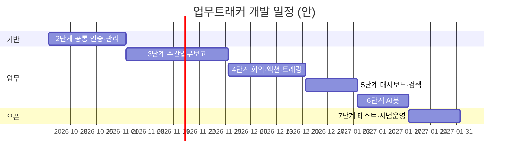

# 업무트래커 개발계획서

| 항목 | 내용 |
|---|---|
| 서비스명 | 업무트래커 (META SYSTEMS 사내 업무 트래킹 시스템) |
| 문서 버전 | v1.0 |
| 작성일 | 2026-10-10 |
| 기준 문서 | 업무트래커_반응형웹_기획서.md v1.0, `GUI/` 화면 시안 10종 |
| 대상 사용자 | 사내 약 30명, 4개 이상 팀 (팀원 · 팀장 · 임원) |
| 플랫폼 | 반응형 웹 (PC · 태블릿 · 모바일) |
| 인프라 | Cloudflare Workers + D1 + R2 |

---

## 1. 개요

### 1.1 개발 목표

엑셀 기반 주간업무보고와 주간회의 지시사항 관리를 하나의 웹 시스템으로 옮긴다.

| 목표 | 성공 기준 |
|---|---|
| 주간업무보고 전산화 | 4개 팀 전원이 시스템에서 작성 · 제출, 엑셀 다운로드가 기존 양식과 동일 |
| 지시사항 추적 | 회의 → 액션 등록 → 부서 진행 → 완료까지 시스템 내에서 끊김 없이 추적 |
| 현황 가시화 | 대시보드에서 전사 / 팀 현황을 1화면에 확인 |
| AI 활용 | 등록 데이터 근거의 질의응답 · 주간 요약 · 지시사항 추출 |

### 1.2 개발 범위

| 구분 | 화면 ID | 화면명 | GUI 시안 |
|---|---|---|---|
| 인증 | LGN-01 | 로그인 | `0 로그인 (오류 상태)@1x.png` |
| 인증 | LGN-02 | 첫 로그인 비밀번호 변경 | `0 첫 로그인 비밀번호 변경@1x.png` |
| 업무 | DSH-01 | 대시보드 | `1 대시보드@1x.png` |
| 업무 | RPT-01 | 주간업무보고 작성 | `2 주간업무보고 작성@1x.png` |
| 업무 | MTG-01 | 회의록 등록 | `3 회의록 등록@1x.png` |
| 업무 | ACT-01 | 액션아이템 등록 | `4 액션아이템 등록@1x.png` |
| 업무 | TRK-01 | 액션트래킹 | `5 액션트래킹 (부서 진행 등록)@1x.png` |
| 업무 | AIB-01 | AI봇 | `6 AI봇@1x.png` |
| 관리 | ADM-01 | 마스터 관리 | `7 마스터 관리 (구분·세부내용)@1x.png` |
| 관리 | ADM-02 | 사원 · 권한 | `8 사원 · 권한@1x.png` |

공통: 사이드바 · 상단 바 레이아웃, 통합 검색(Ctrl K), 시스템 내 알림, 엑셀 다운로드 / 업로드, 파일 · 이미지 첨부.

**범위 제외**: 이메일 · 메신저 알림 연동, SSO, 비밀번호 셀프 찾기, 네이티브 앱.

---

## 2. 기술 스택

| 영역 | 선택 | 비고 |
|---|---|---|
| 프론트엔드 | React 18 + Vite + TypeScript | SPA, Workers Static Assets로 배포 |
| UI | shadcn/ui (Radix UI) + Tailwind CSS | 시안의 zinc 무채색 · shadcn 스타일과 일치 |
| 상태 / 데이터 | TanStack Query, React Router | 서버 상태 캐시, 낙관적 업데이트 |
| 폼 / 검증 | React Hook Form + Zod | Zod 스키마를 API와 공유 |
| 본문 편집기 | Tiptap (ProseMirror) | 굵게 · 글씨색 3종 · 목록 · 들여쓰기 · 이미지 붙여넣기 |
| 차트 | Recharts | 주차별 막대, 부서별 100% 가로 막대 |
| 엑셀 | SheetJS (xlsx) / ExcelJS | 브라우저 생성 · 파싱, 병합 셀 양식 출력은 ExcelJS |
| 백엔드 | Cloudflare Workers + Hono | REST API, 미들웨어(인증 · 권한 · 감사로그) |
| DB | Cloudflare D1 (SQLite) + Drizzle ORM | 마이그레이션은 drizzle-kit / wrangler d1 migrations |
| 파일 | Cloudflare R2 | 본문 이미지, 첨부파일, 로고 |
| 예약 작업 | Workers Cron Triggers | 마감 임박 알림, 장기 미완료 점검 |
| AI | Workers AI 또는 외부 LLM API (미결) | AI Gateway 경유, 로그 · 비용 통제 |
| 검색 | D1 FTS5 | 보고서 · 회의록 · 액션 통합 검색 |
| 글꼴 | Geist + Noto Sans KR | |
| 테스트 | Vitest, Miniflare(@cloudflare/vitest-pool-workers), Playwright | |
| CI/CD | GitHub Actions + Wrangler | dev / prod 환경 분리 |

---

## 3. 시스템 아키텍처



### 3.1 프로젝트 구조 (모노레포)

```
metawork/
├─ apps/
│  ├─ web/                 # React SPA
│  │  ├─ src/components/   # ui(shadcn), layout, editor, badge, chart ...
│  │  ├─ src/features/     # auth, dashboard, report, meeting, action, tracking, aibot, admin
│  │  ├─ src/lib/          # api client, excel, date(주차) 유틸
│  │  └─ src/styles/       # 디자인 토큰
│  └─ worker/              # Hono API
│     ├─ src/routes/       # 도메인별 라우트
│     ├─ src/services/     # 비즈니스 로직 (이월, 제출, 통계 ...)
│     ├─ src/middleware/   # auth, rbac, audit, error
│     ├─ src/cron/         # 예약 작업
│     └─ migrations/
├─ packages/
│  └─ shared/              # Zod 스키마, 코드값 상수, 타입
└─ GUI/                    # 화면 시안
```

### 3.2 인증 · 보안

| 항목 | 방식 |
|---|---|
| 로그인 | 자체 아이디 / 비밀번호, PBKDF2(SHA-256, 100k+ iterations, salt) |
| 세션 | 서버 세션 테이블 + HttpOnly · Secure · SameSite=Lax 쿠키 |
| 잠금 | 5회 연속 실패 시 10분 잠금 (운영 설정값) |
| 첫 로그인 | `must_change_password` 플래그 → LGN-02 외 모든 API 403 |
| 권한 | 미들웨어에서 역할 + 소속 팀 + 추가 권한 검사 (기획서 5장 매트릭스) |
| 감사 로그 | 마스터 · 사원 · 권한 변경, 제출 · 회수, 결정 처리 기록 |
| 파일 | R2 키 비공개, Worker 경유 권한 확인 후 스트리밍 |

---

## 4. 데이터 설계 (개요)

> 상세 컬럼 · 코드값 · 채번 규칙은 **데이터 설계서(ERD · 코드체계)** 에서 확정한다.



| 테이블 | 핵심 컬럼 | 관련 화면 |
|---|---|---|
| department | 팀코드, 팀명, 팀장, 정렬, 사용여부 | ADM-01 |
| employee | 사번, 아이디, 이름, 팀, 직급, 역할, 회의서기, 관리자, 상태, 비밀번호 해시, 실패횟수, 잠금일시 | LGN, ADM-02 |
| session | 토큰 해시, 사원, 만료일시 | LGN |
| code / setting | 공통코드(결과 · 진행여부 · 회의구분 등), 운영 설정 | ADM-01 |
| report_category / report_detail | 구분(KPI · 일반 · 출장및휴가), 팀별 세부내용, 정렬, 사용여부 | ADM-01, RPT-01 |
| weekly_report | 연도, 주차, 팀, 상태(작성중 · 제출 · 지연제출 · 임원확인), 제출일시 | RPT-01, DSH-01 |
| report_title | 번호, 타이틀명, 세부내용, 담당자, 시작주차, 종료주차, 정렬 | RPT-01 |
| title_week_entry | 타이틀×주차, 금주실적(JSON), 수행일, 결과, 차주계획(JSON), 목표기한, 작성완료, version | RPT-01 |
| decision_request | 요청내용, 희망결정일, 상태(대기 · 승인 · 반려 · 보류), 처리자 | RPT-01, DSH-01 |
| attendance | 사원, 유형(출장 · 휴가), 시작 · 종료일, 내용 | RPT-01 |
| meeting / meeting_attendee | 회의구분, 일자, 시간, 장소, 주재, 본문(JSON), 상태 | MTG-01 |
| action_item | 표시번호(AC-), 회의, 회의구분, 일자, 부서, 주제, 요청사항, 진행여부, 완료일, 완료여부 | ACT-01, TRK-01 |
| action_progress | 액션, 등록일, 진행여부, 내용, 작성자 | TRK-01 |
| attachment | 소유 엔티티, R2 키, 파일명, 크기 | 공통 |
| notification | 수신자, 유형, 링크, 읽음여부 | 공통 |
| audit_log | 행위자, 대상, 변경 전후, 일시 | ADM |
| ai_conversation / ai_message | 사용자, 질문, 답변, 출처 목록 | AIB-01 |

**설계 원칙**

- 일정 표현(단일 · 여러 날짜 · 기간 · 기한)은 `{type, dates[]}` JSON 한 컬럼으로 저장.
- 본문은 Tiptap JSON 저장, 검색용 평문 컬럼을 함께 저장해 FTS5 색인.
- 동시 편집 충돌 방지: `title_week_entry.version` 낙관적 잠금 (불일치 시 409 + 안내).
- 삭제 대신 사용여부 / 비활성 처리로 과거 데이터 보존.

---

## 5. API 설계 (주요)

| 도메인 | 메서드 · 경로 | 설명 |
|---|---|---|
| 인증 | `POST /api/auth/login` · `logout` · `GET /me` | 로그인 · 잠금 처리 |
| 인증 | `POST /api/auth/change-password` | 첫 로그인 / 초기화 후 변경 |
| 사원 | `GET/POST/PATCH /api/employees` | 목록 · 등록 · 수정 |
| 사원 | `POST /api/employees/:id/reset-password` · `POST /api/employees/bulk` | 초기화, CSV 일괄등록 |
| 마스터 | `/api/departments`, `/api/report-details`, `/api/codes`, `/api/settings` | CRUD, 정렬 변경 |
| 보고서 | `GET /api/reports/:year/:week?team=` | 주차 보고서 조회 (없으면 자동 이월 생성) |
| 보고서 | `POST /api/reports/:id/titles` · `PATCH /api/titles/:id` | 타이틀 추가 · 수정 · 이동 · 정렬 |
| 보고서 | `PUT /api/entries/:id` | 주간 기록 저장 (version 포함) |
| 보고서 | `POST /api/reports/:id/complete` · `submit` · `recall` | 내 작성 완료, 제출, 회수 |
| 결정 | `GET /api/decisions` · `POST /api/decisions/:id/resolve` | 대기함, 승인 · 반려 · 보류 |
| 근태 | `GET/POST /api/attendance` | 출장 · 휴가 |
| 회의 | `GET/POST/PATCH /api/meetings` | 회의록 |
| 액션 | `POST /api/actions/bulk` · `POST /api/actions/validate-import` | 일괄 등록 · 엑셀 검증 |
| 트래킹 | `GET /api/actions?dept=&status=&from=` · `POST /api/actions/:id/progress` | 목록, 진행 등록 |
| 대시보드 | `GET /api/dashboard?weeks=8&team=` | 카드 · 위젯 집계 |
| 검색 | `GET /api/search?q=` | 통합 검색 |
| 알림 | `GET /api/notifications` · `POST /:id/read` | 알림 목록 · 읽음 |
| 파일 | `POST /api/files` · `GET /api/files/:id` | R2 업로드 · 다운로드 |
| AI | `POST /api/ai/chat` (스트리밍) · `POST /api/ai/extract-actions` · `POST /api/ai/weekly-summary` | AI 기능 |

---

## 6. 단계별 개발 계획 (WBS)

### 6.1 일정 요약

| 단계 | 범위 | 기간 | 일정 (안) | 상태 |
|---|---|---|---|---|
| 1단계 | 개발 환경, DB 기본 스키마, Workers 배포 구조 | — | — | 완료 |
| 2단계 | 공통 UI · 인증 · 사원/권한 · 마스터 | 3주 | 10/12 ~ 10/30 | 다음 |
| 3단계 | 주간업무보고 작성 · 엑셀 다운로드 | 4주 | 11/02 ~ 11/27 | 예정 |
| 4단계 | 회의록 · 액션아이템 · 액션트래킹 · 알림 자동화 | 3주 | 11/30 ~ 12/18 | 예정 |
| 5단계 | 대시보드 · 통합 검색 | 2주 | 12/21 ~ 2027/01/01 | 예정 |
| 6단계 | AI봇 | 2주 | 01/04 ~ 01/15 | 예정 |
| 7단계 | 통합 테스트 · 시범 운영 · 오픈 | 2주 | 01/18 ~ 01/29 | 예정 |



### 6.2 2단계 — 공통 UI · 인증 · 관리 (3주)

| 번호 | 작업 | 산출물 / 완료 기준 |
|---|---|---|
| 2-1 | 디자인 토큰 (zinc 팔레트, 상태색 4종, 글씨색 3종, 글꼴, radius) | `tokens.css`, Tailwind 설정 |
| 2-2 | 공통 레이아웃: 검정 사이드바(248px, 반전 로고, 메뉴, 배지, 사용자), 상단 바(경로, 검색, 알림) | PC 고정 / 1024px 미만 서랍 메뉴 |
| 2-3 | 공통 컴포넌트: 상태 배지, 요약 카드, 필터 칩, 세그먼트 탭, 토글, 데이터 표(가로 스크롤), 상세 패널 | Storybook 또는 샘플 페이지 |
| 2-4 | 일정 선택기 4종 (단일 · 여러 날짜 · 기간 · 기한) | `{type, dates}` 입출력 |
| 2-5 | LGN-01 로그인: 오류 상태(빨간 테두리, 남은 시도 N회), 잠금, 아이디 저장 | 5회 실패 → 10분 잠금 |
| 2-6 | LGN-02 비밀번호 변경: 규칙 4종 실시간 체크, 일치 시 버튼 활성 | 변경 전 타 메뉴 차단 |
| 2-7 | 세션 · RBAC 미들웨어, 메뉴 노출 제어(관리 메뉴는 관리자만) | 권한 매트릭스 단위 테스트 |
| 2-8 | ADM-02 사원 · 권한: 요약 카드 4종, 목록 · 필터, 상세 패널(역할 세그먼트, 추가 권한 토글, 상태, 비밀번호 초기화), 역할별 권한 탭 | 임시 비밀번호 발급 흐름 |
| 2-9 | 사원 CSV 일괄등록 (사번 `S + 숫자 6자리` 필수 검증, 오류 행 표시) | 업로드 미리보기 |
| 2-10 | ADM-01 마스터: 부서 · 구분/세부내용(팀 선택, 드래그 정렬, 사용 현황, 사용 토글, 하단 추가) · 회의구분 · 운영 설정 | 연결 타이틀 있으면 삭제 불가 |
| 2-11 | 감사 로그 · 변경 이력 | 누가 · 언제 · 무엇을 |
| 2-12 | 파일 업로드 API (R2), 시드 데이터(4개 팀, 예시 사원) | |

### 6.3 3단계 — 주간업무보고 작성 (4주)

| 번호 | 작업 | 산출물 / 완료 기준 |
|---|---|---|
| 3-1 | ISO 주차 유틸, 주차 이동, 마감 일시 계산 (운영 설정 반영) | 연말 · 연초 주차 테스트 |
| 3-2 | 본문 편집기 (Tiptap): 굵게, 검정 · 빨강 · 파랑, 글머리 목록, 들여쓰기(- / -> / =>), 이미지 붙여넣기 · 첨부 | 붙여넣기 이미지 R2 저장 |
| 3-3 | 화면 상단: 상태 배지, 주차 · 팀 · 마감, 요약 카드 4종(작성 현황, 타이틀 수, 결정 요청, D-day) | |
| 3-4 | 구분 → 세부내용 → 타이틀 카드 렌더링, 마스터 정렬 순서 반영 | 시안과 동일한 3단(금주 / 결과 / 차주) |
| 3-5 | 결과 버튼 4종(○ → X △) 세로 배치 + 툴팁, 상태별 색 | |
| 3-6 | **자동 이월**: 새 주차 생성 시 계속 · 보류 타이틀 복사, 보류 숨김 · 금주 재개 지원, 지난주 차주계획 → 금주실적 기본값 (이미지 · 색상 포함) | 서버 트랜잭션, 중복 생성 방지 |
| 3-7 | 타이틀 추가(신규 배지, 차주계획부터 시작) · 종료(○ / X → "이번 주 종료", 다음 주 제외) | |
| 3-8 | ∙∙∙ 메뉴: 타이틀명 · 번호 수정, 담당자 변경, 세부내용 이동, 순서 변경, 주차별 진행 이력, 삭제 | |
| 3-9 | 임원 결정 필요 토글 → 결정 요청 입력, 희망 결정일, "결정 대기" 배지, 임원 처리 | 알림 발송 |
| 3-10 | "금주 내용 복사", 자동 저장(디바운스) · 임시저장 | |
| 3-11 | 권한: 팀원 본인 타이틀만, 팀장 팀 전체, 타 팀 열람 전용 | |
| 3-12 | 동시 편집 충돌 처리 (version, 409 안내) | |
| 3-13 | 내 작성 완료 · 팀 보고서 제출 · 회수 · 지연 제출 · 제출 후 잠금 | |
| 3-14 | 출장 및 휴가: 근태 등록, 금주 · 차주 칸 자동 표시, 주 경계 분할 | |
| 3-15 | 필터(전체 / 내 담당 / 결정 필요), 타이틀 검색 | |
| 3-16 | 엑셀 다운로드: 기존 양식 레이아웃(구분 · 세부내용 병합, 금주 / 결과 / 차주) | 기존 엑셀과 대조 검수 |
| 3-17 | 모바일: 금주 / 차주 탭, 편집 타이틀만 펼침, 결과 4칸 가로, 하단 고정 바 | 375px 검수 |

### 6.4 4단계 — 회의록 · 액션 · 트래킹 · 알림 (3주)

| 번호 | 작업 | 산출물 / 완료 기준 |
|---|---|---|
| 4-1 | MTG-01 회의록: 회의 정보(구분, 일자, 시간 · 장소, 주재, 참석자 칩), 본문 편집기, 임시저장 · 등록 및 공유 | 회의 서기만 작성 |
| 4-2 | 회의록 ↔ 연결 액션 건수 · 이동 링크, 엑셀 다운로드 | |
| 4-3 | ACT-01 액션 표: 회의구분 · 일자 · 부서 · 주제 · 요청 사항, 행 추가 · 메뉴 | 연결 회의 선택 시 자동 입력 |
| 4-4 | 양식 다운로드 · 엑셀 업로드 → 미리보기, 오류 행 빨간색(미등록 부서, 빈 값, 날짜 형식) | |
| 4-5 | 등록 및 배정 → 액션 번호 채번(AC-연도-일련번호), 부서장 알림 | |
| 4-6 | TRK-01 요약 카드 4종, 부서 탭(기본: 내 부서), 진행여부 · 회의일자 필터, 완료 숨기기 | |
| 4-7 | 목록 표 (기획서 열 너비 기준), 펼친 행: 진행 이력 + 진행 등록 폼 | |
| 4-8 | 진행 등록: 진행여부(진행중 · 보류 · 완료), 내용, 첨부, "완료" 시 완료일 · 체크 자동 | 완료 행 회색 + 취소선 |
| 4-9 | 알림 센터 (상단 벨, 빨간 점, 목록, 읽음 처리) | |
| 4-10 | Cron: 금요일 오전 마감 임박, 매일 장기 미완료 점검 | 중복 알림 방지 |
| 4-11 | 알림 이벤트 연결: 보고 제출, 결정 요청 / 완료, 액션 배정, 코멘트 | 기획서 2.5 표 전체 |

### 6.5 5단계 — 대시보드 · 통합 검색 (2주)

| 번호 | 작업 | 산출물 / 완료 기준 |
|---|---|---|
| 5-1 | 필터: 기간(최근 8주), 조회 범위 전체 / 팀 세그먼트, 팀 선택 | |
| 5-2 | 요약 카드 5종 (신규 액션, 미완료, 완료율, 평균 소요기간, 장기 미완료-빨강) | 집계 SQL 검증 |
| 5-3 | 주차별 액션아이템 건수 (등록 검정 / 완료 초록 막대) | |
| 5-4 | 부서별 진행상태 100% 가로 막대 (미등록 · 진행중 · 보류 · 완료) | |
| 5-5 | 부서별 완료율 · 평균 소요기간 표 + 미니 막대 | |
| 5-6 | 주의 필요 액션 (D+경과일 순, 클릭 시 트래킹 이동) | |
| 5-7 | 주간업무보고 제출 현황, 임원 결정 대기(검토 버튼) | |
| 5-8 | 반응형: 2단 → 1단, 카드 자동 줄바꿈 | |
| 5-9 | 통합 검색 (Ctrl K 명령 팔레트, FTS5, 결과 유형별 그룹) | |

### 6.6 6단계 — AI봇 (2주)

| 번호 | 작업 | 산출물 / 완료 기준 |
|---|---|---|
| 6-1 | AI 모델 선정 · AI Gateway 설정 (미결 1 해소) | 비용 · 데이터 정책 승인 |
| 6-2 | 검색 기반 컨텍스트 구성 (FTS5 / 필요 시 Vectorize), 권한 범위 필터 | 데이터 외 답변 금지 프롬프트 |
| 6-3 | 채팅 UI: 대화 기록(오늘 · 이번 주 · 지난주), 바로가기 카드 4종, 말풍선, 스트리밍 | |
| 6-4 | 출처 버튼 → 해당 화면 이동, 후속 동작(복사, 대시보드에서 보기) | 모든 답변에 출처 |
| 6-5 | 주간 요약 (대시보드 "AI 주간 요약" 버튼 연동) | |
| 6-6 | 회의록 지시사항 추출 → 액션아이템 등록 미리보기 행 전달 | MTG-01 · ACT-01 연동 |
| 6-7 | 지연 · 리스크 액션 점검 → 부서장 알림 보내기 | |
| 6-8 | 입력창: 범위(전체 / 팀), 기간, 파일 첨부, 하단 면책 안내 | |

### 6.7 7단계 — 통합 테스트 · 시범 운영 · 오픈 (2주)

| 번호 | 작업 |
|---|---|
| 7-1 | 시나리오 테스트: 주간 사이클 1회전 (작성 → 제출 → 회의 → 액션 → 진행 → 완료 → 대시보드) |
| 7-2 | 권한 매트릭스 전수 테스트, 반응형(PC · 태블릿 · 모바일) 검수 |
| 7-3 | 기존 엑셀 데이터 이관 (진행 중 타이틀, 미완료 지시사항) |
| 7-4 | 실사용 계정 등록, 사용자 가이드 · 관리자 가이드 배포 |
| 7-5 | 1개 팀 시범 운영 1주 → 피드백 반영 → 전사 오픈 |

---

## 7. 품질 관리

### 7.1 테스트 전략

| 종류 | 도구 | 대상 |
|---|---|---|
| 단위 | Vitest | 주차 계산, 이월 로직, 권한 판정, 엑셀 변환, 통계 집계 |
| API 통합 | vitest-pool-workers (Miniflare + D1 로컬) | 라우트별 정상 · 권한 오류 · 검증 오류 |
| E2E | Playwright | 로그인, 주간보고 작성 · 제출, 액션 등록 → 트래킹 완료 |
| 시각 · 반응형 | Playwright 스크린샷 (1440 / 768 / 375px) | GUI 시안 대조 |
| 접근성 | axe-core | 터치 대상 44px, 대비, 키보드 조작 |

### 7.2 완료 정의 (DoD)

- GUI 시안과 레이아웃 · 상태 색 · 문구 일치
- 권한 매트릭스에 맞는 API 차단 테스트 통과
- 1024px 미만 · 375px 레이아웃 확인
- 감사 로그 대상 기능은 이력 기록 확인
- 코드 리뷰 승인, CI 통과

### 7.3 환경 · 배포

| 환경 | 용도 | 배포 |
|---|---|---|
| local | 개발 (wrangler dev, 로컬 D1) | — |
| dev | 내부 검수 | main 브랜치 머지 시 자동 |
| prod | 운영 | 태그 릴리스 + 수동 승인 |

- D1 마이그레이션은 배포 파이프라인에서 적용, 운영 반영 전 백업(D1 Time Travel / export).
- 비밀값(AI 키, 세션 서명 키)은 `wrangler secret`으로 관리.

---

## 8. 리스크 및 대응

| 리스크 | 영향 | 대응 |
|---|---|---|
| 자동 이월 로직 오류 (데이터 누락 · 중복) | 높음 | 서버 트랜잭션 + 유니크 제약(타이틀×주차), 이월 전용 테스트 케이스 |
| 기존 엑셀 양식 재현 난이도 (병합 · 색상) | 중간 | ExcelJS로 템플릿 기반 출력, 3단계 초기에 샘플 대조 |
| 동시 편집 충돌 | 중간 | 타이틀×주차 단위 저장 + version 낙관적 잠금 |
| D1 쿼리 성능 (대시보드 집계) | 낮음 | 사용자 30명 규모로 충분, 인덱스 · 필요 시 집계 캐시 |
| AI 모델 · 데이터 반출 정책 미확정 | 중간 | 6단계를 마지막에 배치, 인터페이스 추상화로 모델 교체 가능 |
| 편집기 이미지 붙여넣기 용량 | 낮음 | 클라이언트 리사이즈 · 용량 제한(예: 10MB) |

---

## 9. 미결 사항 (개발 영향)

| 번호 | 항목 | 결정 필요 시점 | 영향 단계 |
|---|---|---|---|
| 1 | AI봇 모델 선정 (Workers AI / 외부 API) | 5단계 종료 전 | 6단계 |
| 2 | 대시보드 기본 조회 범위 역할별 차등 여부 | 5단계 시작 전 | 5단계 |
| 3 | 비밀번호 규칙 · 잠금 기준 최종값 | 2단계 중 | 2단계 (설정값이라 변경 용이) |
| 4 | 공식 반전(화이트) 로고 파일 | 오픈 전 | 2단계 · 7단계 |
| 5 | 액션아이템 등록 "엑셀" 버튼 명칭 | 4단계 시작 전 | 4단계 |
| 6 | 프론트엔드 스택 확정 (React + shadcn/ui 제안) | 2단계 착수 시 | 전체 |
| 7 | 기존 엑셀 데이터 이관 범위 (기간 · 대상) | 6단계 중 | 7단계 |
